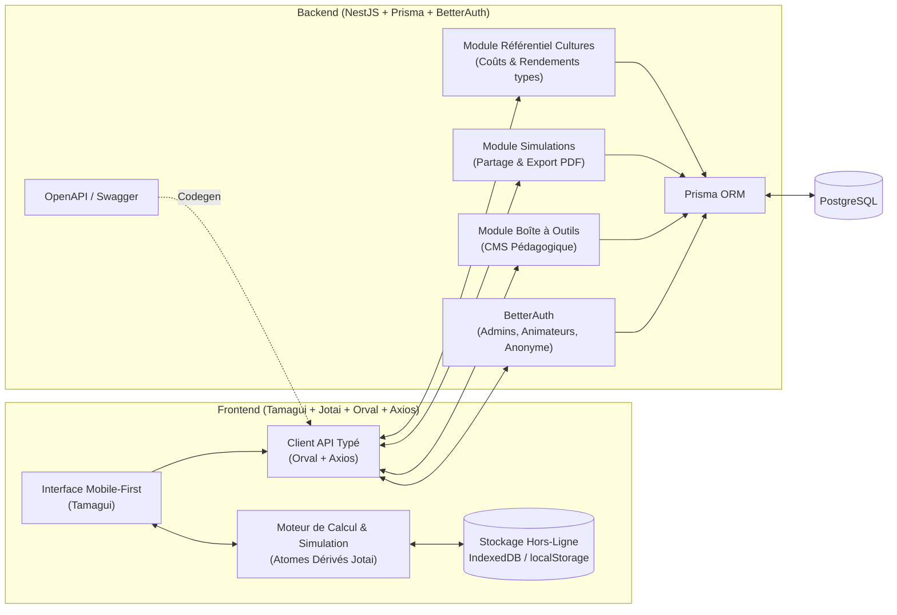

# Projet AVENIR — Boîte à Outils Numérique Interactive & Simulateur Économique Agricole

> **Client / Mise en œuvre :** RIKOLTO (Afrique de l'Est en RDC)  
> **Partenaires financiers :** FIDA, AFD, FEM/GEF  
> **Zones d'intervention :** Provinces du Kwilu et du Kwango (RDC)  
> **Filières phares :** Café, Cacao et cultures vivrières/associées  
> **Durée de la mission :** 8 semaines  

---

## 1. Vision et Objectifs du Projet

Le **Projet AVENIR** (*Autonomisation par l'Entrepreneuriat Agricole et Rural Inclusif, Résilient et Sensible à la Nutrition*) vise à renforcer les capacités entrepreneuriales et décisionnelles des ménages agricoles, producteurs individuels, organisations paysannes (OP), jeunes entrepreneurs et animateurs de terrain.

La plateforme numérique réunit **deux composantes complémentaires** au sein d'une solution unique, fluide, utilisable sur smartphone, résiliente aux faibles connexions et **accessible sans création de compte obligatoire** :

1. **Composante 1 — Simulateur Économique Agricole Interactif :**
   - Planification culturale et budgétaire (superficie, rendements, intrants, main-d'œuvre, équipements).
   - Saisie granulaire des coûts sur tout le cycle (préparation du terrain, semences/matériel végétal, semis, entretien, intrants, main-d'œuvre, récolte/post-récolte, transport/stockage/commercialisation).
   - Estimation des recettes (production attendue vs commercialisée, prix de vente, revenus annexes).
   - Calcul automatique des indicateurs : coût total, coût de revient unitaire, recettes totales, marge brute, bénéfice/perte net(te), seuil de rentabilité (point mort).
   - **Simulation inversée (Objectif de revenu)** : ex. *« Je veux générer 1 000 USD de bénéfice : combien dois-je investir, quelle superficie exploiter et quelle quantité produire/vendre ? »*
   - **Analyse de sensibilité (« Et si ? ») et comparaison multi-scénarios** (baisse des prix, hausse des intrants, comparaison de 2 à 3 scénarios côte à côte).
   - **Export & sauvegarde sans compte** : sauvegarde locale sur l'appareil, export PDF/image (fiche récapitulative partageable via WhatsApp/impression) et lien/code de partage.

2. **Composante 2 — Boîte à Outils Pédagogique Interactive (Éducation Entrepreneuriale) :**
   - Bibliothèque structurée par thématiques (Gestion d'exploitation, Planification, Calcul des coûts, Commercialisation, Entrepreneuriat agricole, Prise de décision, Nutrition & résilience).
   - Fiches pratiques illustrées, guides visuels, supports pour animateurs de terrain et glossaire simplifié.
   - **Pont contextuel avec le simulateur** : infobulles pédagogiques et liens directs entre les notions théoriques (ex. *Marge brute*, *Seuil de rentabilité*) et le simulateur économique.
   - Espace d'administration (CMS) dédié à l'équipe Rikolto pour publier, traduire et mettre à jour les référentiels de cultures et les contenus pédagogiques.

---

## 2. Stack Technique & Architecture

### Frontend (Application Web Responsive & Mobile-First — 100% Compatible Smartphones)
> **Note d'architecture :** La solution est une **Application Web (Web App / PWA)** accessible directement via navigateur (aucune installation de store requise), conçue en **Mobile-First** pour offrir une ergonomie optimale sur les smartphones ainsi que sur tablettes et ordinateurs.

- **UI & Design System :** [Tamagui (Web)](https://tamagui.dev/) — Système de design et composants Web réactifs (`@tamagui/core` / `tamagui`), optimisés pour les écrans tactiles de smartphones (boutons larges, lisibilité en extérieur, chargement léger) et adaptatifs sur grand écran.
- **Gestion d'état & Persistance Locale :** [Jotai](https://jotai.org/) — État atomique réactif pour les calculs économiques instantanés en temps réel (`atom`, atomes dérivés pour les formules financières, `atomWithStorage` sur `localStorage`/`IndexedDB` pour fonctionner **100% hors-ligne et sans compte**).
- **Client HTTP & Synchronisation :** [Axios](https://axios-http.com/) — Instance configurée avec intercepteurs de cache, gestion des erreurs réseau et file d'attente hors-ligne.
- **Génération du Client API :** [Orval](https://orval.dev/) — Génération automatique des clients Axios et des schémas TypeScript directement depuis la spécification OpenAPI (Swagger) de NestJS.

### Backend (API, Référentiels, CMS & Synchronisation)
- **Framework Backend :** [NestJS](https://nestjs.com/) — Architecture modulaire, validation stricte (`class-validator`), documentation OpenAPI (`@nestjs/swagger`) servant de source de vérité à Orval.
- **Base de Données :** **PostgreSQL** — Stockage relationnel robuste pour les référentiels agricoles, les contenus pédagogiques et les simulations sauvegardées/partagées.
- **ORM :** [Prisma](https://www.prisma.io/) — Schéma déclaratif, migrations typées et requêtes performantes.
- **Authentification & Rôles :** [BetterAuth](https://www.better-auth.com/) — Authentification moderne :
  - **Accès Public / Invité (par défaut) :** Aucune authentification requise pour utiliser le simulateur ou consulter la boîte à outils.
  - **Mode Session Anonyme / Code de reprise :** Permet de retrouver ou partager une simulation sans compte personnel.
  - **Comptes Administrateurs Rikolto & Animateurs :** Gestion sécurisée des rôles (`ADMIN`, `EDITOR`, `FACILITATOR`) pour administrer les référentiels de cultures, valider les contenus pédagogiques et suivre les statistiques anonymisées d'utilisation.

### Schéma d'Architecture Globale



---

## 3. Structure du Monorepo

```text
Projet-Avenir/
├── apps/
│   ├── api/                        # Backend NestJS + Prisma + BetterAuth
│   │   ├── prisma/
│   │   │   ├── schema.prisma       # Modèles de données PostgreSQL
│   │   │   └── seed.ts             # Données initiales (Café, Cacao, Maïs, Manioc, etc. + Fiches)
│   │   └── src/
│   │       ├── auth/               # Configuration BetterAuth & Guards RBAC
│   │       ├── crops/              # Référentiels cultures, unités locales, étapes de production
│   │       ├── simulations/        # Sauvegarde optionnelle, partage par code, statistiques
│   │       ├── toolbox/            # Contenus pédagogiques, catégories, médias, fiches
│   │       └── main.ts             # Bootstrap NestJS + Export OpenAPI JSON pour Orval
│   └── web/                        # Frontend Tamagui + Jotai + Orval + Axios (PWA)
│       ├── src/
│       │   ├── api/                # Code généré par Orval + instance Axios
│       │   ├── atoms/              # État Jotai (simulateur, scénarios, objectifs, hors-ligne)
│       │   ├── components/         # Composants UI Tamagui (formulaires, jauges, cartes, tableaux)
│       │   ├── features/
│       │   │   ├── simulator/      # Assistant de simulation, mode inversé, comparateur
│       │   │   ├── toolbox/        # Bibliothèque pédagogique interactive
│       │   │   └── admin/          # Back-office Rikolto (gestion cultures & contenus)
│       │   └── utils/              # Moteur mathématique agricole, export PDF, formatage CDF/USD
│       └── orval.config.ts         # Configuration Orval pointant sur le Swagger NestJS
├── packages/
│   └── shared/                     # Formules économiques partagées, constantes et types
├── docker-compose.yml              # PostgreSQL local + environnements de dev
└── README.md                       # Plan directeur du projet
```

---

## 4. Modélisation des Données (Prisma / PostgreSQL)

### 4.1. Entités Principales
1. **`User` / `Session` / `Account` (BetterAuth) :**
   - Rôles : `ADMIN` (Équipe Rikolto), `FACILITATOR` (Animateur terrain), `PRODUCER` (optionnel).
2. **`CropTemplate` (Référentiel de Culture) :**
   - Cultures pré-configurées pour le Kwilu et le Kwango (Café, Cacao, Manioc, Maïs, Arachide, Niébé, etc.).
   - Unités locales supportées : Hectare (`ha`), Are (`a`), Mètre carré (`m²`), Sac (50kg, 100kg), Bassine, Kg, Tonne.
   - Devises supportées : **USD** et **CDF** (Franc Congolais) avec taux de change configurable par l'utilisateur.
   - Coûts et rendements de référence par défaut (modifiables librement par l'utilisateur).
3. **`ExpenseStage` (Étapes du cycle de production) :**
   - `LAND_PREP` : Préparation et aménagement du terrain
   - `SEEDS` : Achat des semences ou du matériel végétal (boutures, plants de café/cacao)
   - `PLANTING` : Semis ou plantation
   - `MAINTENANCE` : Entretien des cultures (sarclage, taille, phytosanitaire)
   - `INPUTS` : Achat des intrants et autres consommables (engrais bio/chimiques, sacs, petits outils)
   - `LABOR` : Main-d'œuvre (familiale valorisée ou salariée)
   - `HARVEST` : Récolte et post-récolte (séchage, fermentation, décorticage)
   - `LOGISTICS` : Transport, stockage et commercialisation
4. **`Simulation` & `SimulationScenario` :**
   - Fonctionne d'abord en local dans Jotai (`atomWithStorage`).
   - Peut être synchronisée sur PostgreSQL sans compte via un `shareCode` court (ex: `AVN-8492`) pour qu'un producteur puisse la montrer à un animateur.
5. **`ToolboxCategory` & `ToolboxArticle` :**
   - Thématiques pédagogiques, fiches pratiques illustrées, conseils contextuels liés aux indicateurs du simulateur (ex: alerte pédagogique si le coût de transport dépasse X% du coût total).

---

## 5. Moteur de Calcul Économique & Formules (Composante 1)

Toutes les formules sont exécutées **instantanément côté client via des atomes dérivés Jotai** (zéro latence réseau) et validées côté backend :

1. **Coût Total de Production ($CT$) :**
   $$CT = \sum_{i=1}^{8} C_{\text{étape } i} = C_{\text{fixe}} + C_{\text{variable}}$$
2. **Coût de Production Unitaire ($CU$) :**
   $$CU = \frac{CT}{Q_{\text{produite}}}$$
3. **Recettes Totales Estimées ($RT$) :**
   $$RT = (Q_{\text{commercialisée}} \times P_{\text{vente}}) + R_{\text{autres}}$$
   *(Permet aussi de valoriser la part autoconsommée par le ménage pour la sensibilité à la nutrition).*
4. **Marge Brute ($MB$) & Résultat Net / Bénéfice ($B$) :**
   $$MB = RT - C_{\text{variables}}$$
   $$B = RT - CT$$
5. **Seuil de Rentabilité / Point Mort ($SR$) :**
   - **En quantité ($Q_{\text{seuil}}$)** : quantité minimale à vendre au prix $P_{\text{vente}}$ pour couvrir $CT$ :
     $$Q_{\text{seuil}} = \frac{CT}{P_{\text{vente}}}$$
   - **En prix minimum ($P_{\text{seuil}}$)** : prix de vente minimum par unité pour ne pas vendre à perte :
     $$P_{\text{seuil}} = \frac{CT}{Q_{\text{commercialisée}}}$$
6. **Mode Simulation Inversée (Objectif de Bénéfice $B_{\text{cible}}$) :**
   - Pour atteindre un bénéfice cible (ex: $1\,000\text{ USD}$) :
     - Quantité à vendre nécessaire : $Q_{\text{requise}} = \frac{CT + B_{\text{cible}} - R_{\text{autres}}}{P_{\text{vente}}}$
     - Superficie requise (selon rendement moyen $Y$) : $S_{\text{requise}} = \frac{Q_{\text{requise}}}{Y}$
     - Investissement total requis ajusté proportionnellement à la superficie.
7. **Simulateur de Sensibilité (« Et si ? ») :**
   - Curseurs interactifs (sliders Tamagui) faisant varier le prix de vente ($-30\%$ à $+30\%$), le rendement ou le coût des intrants avec comparaison visuelle immédiate entre **Scénario de Base**, **Scénario Optimiste** et **Scénario Pessimiste**.

---

## 6. Plan de Travail Détaillé (8 Semaines — Aligné sur les TdR)

| Semaine | Étape TdR | Livrables & Travaux Techniques |
| :--- | :--- | :--- |
| **Semaine 1** | **Étape 1 : Cadrage & Analyse des besoins** | - Réunion de démarrage avec Rikolto.<br>- Collecte des référentiels agricoles Kwilu/Kwango (cultures, unités locales, coûts moyens).<br>- Initialisation du monorepo (`NestJS + Prisma + Postgres + BetterAuth` & `Tamagui + Jotai + Orval + Axios`). |
| **Semaine 2** | **Étape 2 : Conception & Prototypage** | - Validation du schéma Prisma et des formules économiques.<br>- Maquettes interactives (UI/UX Tamagui mobile-first, faible littératie numérique, icônes explicites).<br>- Structuration de l'arborescence de la Boîte à Outils pédagogique.<br>- Validation du prototype par Rikolto. |
| **Semaines 3 à 5** | **Étape 3A : Développement du Simulateur Économique (Composante 1)** | - **S3 :** API NestJS (`crops`, `simulations`) + Génération Orval + Atomes Jotai de planification et saisie des 8 postes de dépenses.<br>- **S4 :** Calculs automatiques des recettes, marges, coût unitaire, seuil de rentabilité + Mode Simulation Inversée (objectif de revenu).<br>- **S5 :** Comparateur multi-scénarios, curseurs « Et si ? », graphiques visuels, mode hors-ligne (PWA/IndexedDB) et export PDF sans compte. |
| **Semaines 4 à 6** | **Étape 3B : Développement de la Boîte à Outils Interactive (Composante 2)** | - **S4 :** Schéma et API CMS (`toolbox`) + Authentification BetterAuth pour les administrateurs Rikolto.<br>- **S5 :** Interface publique de la Boîte à Outils (catégories, fiches pratiques, recherche, lecture hors-ligne, quiz/conseils).<br>- **S6 :** Liaison contextuelle Simulateur ↔ Boîte à Outils + Intégration des contenus validés par l'équipe AVENIR. |
| **Semaine 7** | **Étape 4 : Tests & Validation pilote** | - Tests unitaires et validation mathématique des formules économiques.<br>- Tests d'utilisabilité sur smartphones auprès d'un groupe pilote de producteurs et d'animateurs.<br>- Tests du mode hors-ligne et optimisation des performances. |
| **Semaine 8** | **Étape 5 : Déploiement & Transfert de compétences** | - Corrections finales et mise en production.<br>- Formation des équipes Rikolto et des animateurs désignés.<br>- Remise des manuels utilisateurs, documentation technique, accès admin et code source complet + Rapport final. |

---

## 7. Principes d'Accessibilité Terrain (Kwilu & Kwango)

1. **Zéro barrière à l'entrée (Sans Compte) :** Dès l'ouverture de l'application, l'utilisateur accède directement à **« Lancer une simulation »** ou **« Explorer la boîte à outils »**.
2. **Pré-remplissage intelligent :** L'utilisateur peut partir d'un modèle pré-rempli (ex: *1 ha de Café*, *0.5 ha de Manioc*) ou partir de zéro.
3. **Unités et Monnaies Locales :** Bascule instantanée entre **USD ($)** et **Franc Congolais (CDF)**, et conversion souple des unités locales (hectare, are, sac, bassine, kg).
4. **Offline-First (PWA) :** Grâce à Jotai (`atomWithStorage`) et au Service Worker PWA, un animateur ou producteur peut réaliser toutes ses simulations et consulter les fiches pédagogiques au champ sans couverture réseau.
5. **Pédagogie Visuelle :** Utilisation de codes couleurs universels (Vert = Rentable, Orange = Équilibre fragile, Rouge = Perte), pictogrammes pour chaque étape agricole et résumé exécutif en langage simple.

---

## 8. Prochaines Étapes Immédiates (Démarrage Technique)

1. **Initialisation de l'infrastructure :**
   - Mise en place du `docker-compose.yml` (PostgreSQL).
   - Création du backend `apps/api` (NestJS, Prisma, Swagger, BetterAuth).
   - Création du frontend `apps/web` (Tamagui, Jotai, Axios, Orval).
2. **Implémentation du Socle (MVP Semaine 1-2) :**
   - Schéma Prisma complet (`CropTemplate`, `Simulation`, `ToolboxArticle`, `User`).
   - Seed initial avec les cultures phares du projet AVENIR (Café, Cacao, Manioc, Maïs, Arachide).
   - Pipeline Orval générant automatiquement les appels Axios typés depuis NestJS.
   - Premier écran Tamagui du simulateur connecté aux atomes Jotai.

